# Databaseschema

Migraties: `0001_core_schema.sql` (tabellen), `0002_audit_and_rls.sql` (audit, RLS), `0003_import_payload.sql`,
`0004_role_membership.sql` (SET-recht op `app_user`), `0005_browser_gateway.sql` (toegang vanuit de browser via
`di_sql`/`di_batch`/`di_demo_users`, directe API-toegang afgesloten) en `0006_deferred_check_definer.sql`.

## Ontwerpprincipes

- UUID-primaire sleutels (`gen_random_uuid()`), foreign keys, `CHECK`-constraints voor domeinwaarden (gelijk aan `src/lib/domain.ts`).
- `created_at/updated_at/created_by/updated_by` via triggers; `created_by` kan niet worden vervalst (trigger vult `app.uid()`).
- **Archiveren** (`archived_at`) in plaats van verwijderen voor inhoudelijke tabellen; fysiek verwijderen alleen door admin.
- **Onbekend ≠ 0**: numerieke velden zoals capaciteit, budget, voortgang en KPI-waarden zijn `NULL` tot ze bekend zijn.
- **Versiebeheer**: prioriteringsmodellen krijgen een nieuwe versie bij wijziging (sessies verwijzen naar hun versie);
  beoordelingen hebben een `revision`-teller en een onveranderlijke revisietabel; jaarplanversies zijn snapshots.

## ERD (kern)

```mermaid
erDiagram
  users ||--o{ user_roles : heeft
  roles ||--o{ user_roles : ""
  disciplines ||--o{ users : ""
  pillars ||--o{ pillar_objectives : ""
  pillars ||--o{ topics : ""
  pillars ||--o{ programs : ""
  programs ||--o{ topics : bundelt
  topics ||--o{ topic_sources : ""
  source_inputs ||--o{ topic_sources : "herleidbaar"
  import_batches ||--o{ source_inputs : ""
  topics ||--o{ topic_classifications : ""
  topics ||--o{ topic_disciplines : ""
  topics ||--o| topic_assessments : deepdive
  topics ||--o{ maturity_assessments : ""
  topics ||--o{ feasibility_assessments : ""
  topics }o--o| topics : "merged_into / split_from"
  projects ||--o{ project_topics : ""
  topics ||--o{ project_topics : ""
  pillars ||--o{ projects : "primaire pijler"
  projects ||--o{ project_pillars : "secundair"
  programs ||--o{ projects : ""
  projects ||--o{ project_members : ""
  projects ||--o{ project_updates : ""
  projects ||--o{ milestones : ""
  projects ||--o{ tasks : ""
  projects ||--o{ project_dependencies : ""
  projects ||--o{ expenses : ""
  priority_models ||--o{ priority_criteria : ""
  priority_models ||--o{ priority_sessions : versie
  priority_sessions ||--o{ priority_session_members : ""
  priority_sessions ||--o{ priority_session_items : ""
  priority_session_items ||--o{ priority_assessments : ""
  priority_assessments ||--o{ priority_scores : ""
  priority_criteria ||--o{ priority_scores : ""
  priority_session_items ||--o{ priority_decisions : ""
  recurring_activities }o--|| disciplines : ""
  staffing_positions }o--|| disciplines : ""
  staffing_scenarios ||--o{ staffing_scenario_positions : ""
  skills ||--o{ position_skills : ""
  staffing_positions ||--o{ position_skills : ""
  capacity_periods ||--o{ capacity_allocations : ""
  risks ||--o{ risk_measures : ""
  kpis ||--o{ kpi_measurements : ""
  annual_plans ||--o{ annual_plan_versions : ""
  annual_plans ||--o{ annual_plan_projects : ""
  decisions }o--o| projects : ""
  decisions }o--o| pillars : ""
  decisions }o--o| staffing_scenarios : "formatievoorstel"
```

Overige tabellen: `budgets`, `suppliers`, `regulatory_requirements`, `comments`, `attachments` (verwijzingen naar goedgekeurde
documentopslag), `saved_views` (opgeslagen filterweergaven), `work_sessions` (werksessie hervatten), `settings`,
`audit_logs`, `priority_assessment_revisions`, `schema_migrations`.

## Uitbreidingen 0007–0008 (vereenvoudigde opzet)

- `topics.owner_name`, `kpis.owner_name`, `projects.lead_name`: naam van een teamlid of een vaste keuze
  (*Geen persoon beschikbaar*, *Geen capaciteit (nog niet toe te wijzen)*; zie `src/lib/domain.ts`). Leeg = nog niet bepaald.
- `team_members` (naam uniek, functie, soort Vast/Inhuur, actief): keuzelijst voor eigenaar/trekker. RLS en audit zoals overige tabellen.
- `pillars.ambition_q1..q4`: ambitie 2027 per kwartaal.
- `projects.planner_task_id` (uniek indien gevuld), `planner_url`, `description`.

## Belangrijke constraints

| Constraint | Doel |
|---|---|
| `topic_flag_rationale` | Markering (wettelijk verplicht, harde deadline, …) vereist onderbouwing |
| `topic_hard_deadline_date` | Harde deadline vereist datum |
| `priority_criteria_weight_sum` (deferred constraint trigger) | Som gewichten per model = 100 |
| `deviation_requires_rationale` | Definitieve prioriteit ≠ consensus vereist motivering ≥ 10 tekens |
| `priority_models_one_active` | Precies één actief model |
| `source_inputs_immutable` (trigger) | Oorspronkelijke input kan niet worden gewijzigd |
| `project_dependencies` check + cyclusdetectie (server) | Geen zelf- of kringafhankelijkheden |
| `guard_topic_priority` (trigger) | Alleen de teamleider wijzigt de vastgestelde prioriteit |
| `decisions` check | Genomen besluit vereist besluitdatum |

## Row Level Security

Alle tabellen hebben RLS. De applicatie werkt als rol `app_user` met `app.user_id` per transactie; in de statische variant
zet `di_sql` deze waarde op de gekozen demorol. Hulpfuncties:
`app.uid()`, `app.has_any_role(text[])`, `app.can_edit_project(uuid)`, `app.can_see_assessment(item, user)`.

| Domein | Lezen | Schrijven |
|---|---|---|
| Pijlers, onderwerpen, programma's, projecten, KPI's, wetgeving, leveranciers | alle ingelogde gebruikers | volgens rol (zie Beheer → Rollen en rechten) |
| Projecten en onderdelen | iedereen | admin, teamleider, projectleider van het project, projectleden |
| Prioriteringsbeoordelingen | eigen beoordeling; die van anderen pas bij status *Bespreking/Afgerond* of als blind stemmen uit staat | alleen eigen, alleen als deelnemer van een open sessie; consensus door teamleider/admin; geen delete |
| Definitieve prioriteit (`priority_decisions`) | iedereen | alleen teamleider |
| Formatie, scenario's, budgetten | teamleider, admin, management | teamleider, admin |
| Vertrouwelijke risico's | teamleider, admin, management, eigenaar, melder | idem + admin/teamleider |
| Auditlog | teamleider, admin | niemand (alleen via trigger) |
| Opgeslagen weergaven | eigenaar | eigenaar |

## Auditlog

Trigger `app.audit()` (security definer) op o.a. users, user_roles, pillars, topics, beoordelingen, prioriteringsbesluiten,
projecten, risico's, besluiten, instellingen, budgetten en formatie. Per wijziging: tabel, record, actie, oude en nieuwe
waarde, gewijzigde velden, gebruiker en tijdstip. Zichtbaar in Beheer → Wijzigingshistorie en per object.

## Rekenregels en aggregaties

- Dashboard- en pijlercijfers worden live uit brontabellen berekend (`src/server/queries/dashboard.ts`).
- Prioriteitsscore wordt berekend met de criteria van de sessieversie en als snapshot opgeslagen (`total_score`, `category`).
- Consensus wordt voorgevuld met de mediaan per criterium (afgerond op heel getal, .5 naar boven).
- Capaciteit: "Planning vaststellen" genereert regels in `capacity_allocations` (beschikbaar uit bezetting, regulier uit
  het basispakket, project naar rato van looptijd); eerder gegenereerde regels voor dat jaar worden vervangen, handmatige
  regels blijven. Scenario's worden live doorgerekend zonder de vastgestelde planning te wijzigen.
